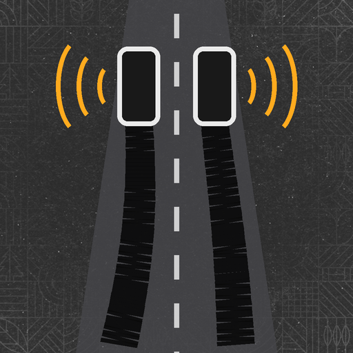

# Hard Braking – FS25

Slam the brakes and hear the tyres scream. **Hard Braking** adds locked wheels, tyre screech and real skid marks to Farming Simulator 25.

## Features
- **Locked wheels**: brake hard at speed and the wheels stop turning while the vehicle skids
- **Tyre screech**: realistic squeal, louder the faster you go
- **Skid marks**: black marks stay on the road behind every wheel, also on trailers
- **Asphalt and concrete only**: no marks and no screech on fields, grass, gravel or dirt
- Skid marks fade away after 30 minutes
- Works for tractors, trucks, cars and every vehicle you drive. Helpers and crashes leave marks too

## Console
| Command | What it does |
|---|---|
| `hbInfo` | Braking status and the surface under the vehicle |
| `hbTest` | Skid for 3 seconds |
| `hbClear` | Remove all skid marks |
| `hbVolume 0..2` | Screech volume |
| `hbSensitivity 2.5` | How hard you must brake (lower = easier) |

## Install
Download **FS25_HardBraking.zip** from the [latest release](../../releases/latest) and put it in your `mods` folder. Do not unzip it.

## Info
- Game: Farming Simulator 25
- Multiplayer supported
- Author: **FS Modding**

## License
Free to use. Do not reupload, sell or publish modified versions without permission. See [LICENSE](LICENSE).
